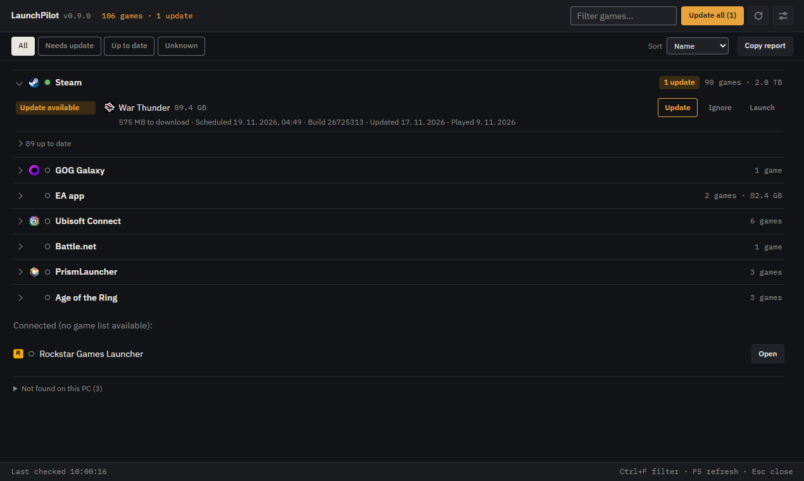

<div align="center">


# LaunchPilot

**One dashboard for every game launcher on your PC.**

See what needs updating across Steam, Epic, GOG, EA, Ubisoft Connect, Battle.net, Riot, PrismLauncher, Wargaming Game Center, and Age of the Ring — and trigger updates without opening ten different apps.

[](https://github.com/vxkShelby/Launch-Pilot/releases/latest)
[](https://github.com/vxkShelby/Launch-Pilot/actions/workflows/release.yml)
[](https://github.com/vxkShelby/Launch-Pilot/releases)




</div>

## Why

Every launcher has its own "check for updates" button, buried in its own window. LaunchPilot reads
what each launcher already knows locally — no accounts, no passwords, no scraping — and puts it in
one dense, dark dashboard. Nothing here is invented: if a launcher doesn't expose a real way to know
whether an update is pending, LaunchPilot says **Unknown** instead of guessing.

## What it does

- Lists installed games per launcher, each in its own collapsible section, with the launcher's and each game's real local icon.
- Shows a status per game: **Up to date**, **Update available**, **Updating…**, or **Unknown**.
- **Update** button on games with an update available, and **Update all (N)** to trigger every pending one in sequence. Update opens the real launcher on that game (see the table); the launcher does the download.
- **Launch** button on games for Steam, GOG Galaxy, EA app and Ubisoft Connect (Ubisoft games installed through Steam are launched via Steam). Other launchers have no verified per-game launch path, so no button is shown.
- Shows whether each launcher's process is running (a dot next to its name).
- Filter box, manual refresh, and auto-refresh (Off / 15 / 30 / 60 minutes, default 30).
- A first-run welcome dialog that explains the status labels and the "Unknown means we won't guess" rule.
- Updates itself: checks this repo's releases on startup and on the refresh timer, and installs signed updates.

## What's real, per launcher

"Update status ✅" means LaunchPilot can detect a pending update; "live Updating" means it can only detect an install currently in progress, and otherwise says Unknown.

| Launcher | Detect | Game list | Update status | Launch button | Update trigger |
|---|:---:|:---:|:---:|:---:|---|
| **Steam** | ✅ | ✅ | ✅ (`StateFlags` + build id vs. target build id) | ✅ `steam://rungameid/<appid>` | `steam://validate/<appid>` |
| **Epic Games** | ✅ | ✅ | live "Updating" (`bIsIncompleteInstall` + staging writes) | — | none (no update-only mechanism exists; opens the Epic client) |
| **GOG Galaxy** | ✅ | ✅ | ✅ installed build vs. `content-system.gog.com` (no login) | ✅ game exe | `goggalaxy://openGameView/<id>` |
| **EA app** | ✅ | ✅ (registry) | live "Updating" (recent `.tmp` staging writes); a stalled `.tmp` shows "Update available" | ✅ game exe | `origin2://` (opens client) |
| **Ubisoft Connect** | ✅ | ✅ (registry + Steam cross-detect) | Unknown *(no local field exists)* | ✅ game exe, or via Steam for Steam-installed titles | `uplay://` (opens client) |
| **Battle.net** | ✅ | ✅ (registry, known-product table) | live "Updating" (log-based) | — | `battlenet://` (opens client) |
| **Riot Client** | ✅ | ✅ (light) | Unknown *(no local field exists)* | — | launches `RiotClientServices.exe` |
| **PrismLauncher** | ✅ | ✅ | ✅ launcher itself (GitHub releases) + per-mod (Modrinth pack instances only) | — | launches `prismlauncher.exe` |
| **Wargaming Game Center** | ✅ | ✅ (`preferences.xml`) | ✅ (`game_info.xml` installed vs. available) | — | launches `wgc.exe` (found by drive scan, heuristic) |
| **Rockstar Games Launcher** | ✅ (registry + `Launcher.exe`) | — *(game list is opaque binary)* | — | — | opens the launcher only |
| **Age of the Ring** | heuristic (drive scan, no installer footprint) | ✅ (mod + 2 base games) | Unknown *(no local field exists)* | — | launches `AotR_Launcher.exe` |

Steam is the reference implementation: full local visibility into what's installed, what build it's
on, and whether Valve has a newer one queued. The others get exactly as much automation as their
local data honestly supports; the rest is one click into the real launcher. Ubisoft's running
status comes from a command-line check (`-upc_desktop_mode` marks the background helper, not the
real client).

Every launcher and game also shows its real local icon (pulled from Windows' own icon cache for
that launcher's client exe, or that specific game's own exe/registry-declared icon), never a
bundled or guessed image. Where none is found, none is shown.

## Privacy & support

No accounts, no telemetry, no analytics. The only network requests are each launcher's public update
endpoint (e.g. GOG, GitHub, Modrinth) and a check for a newer LaunchPilot release. See
[PRIVACY.md](PRIVACY.md) for exactly what LaunchPilot does and doesn't send. Bug reports and questions go through
[SUPPORT.md](SUPPORT.md) (GitHub Issues + Discussions).

## Dev

```bash
npm install
npm run tauri dev
```

Rust unit tests:

```bash
cd src-tauri && cargo test
```

## Self-update signing (CI secrets)

Updates are signed with a minisign keypair generated via `npx tauri signer generate`. The public
key lives in `src-tauri/tauri.conf.json` (`plugins.updater.pubkey`). The private key must **never**
be committed — it's gitignored (`src-tauri/*.key`).

To wire up CI signing, add two repo secrets (Settings → Secrets and variables → Actions):

- `TAURI_SIGNING_PRIVATE_KEY` — contents of `src-tauri/launchpilot-updater.key`
- `TAURI_SIGNING_PRIVATE_KEY_PASSWORD` — the password used when generating the key

Losing either means you can no longer publish updates users' existing installs will trust — back
both up somewhere durable (password manager) outside this repo.

## Releasing

Push a tag matching `v*` (e.g. `v0.2.0`) or run the `release` workflow manually. `tauri-action`
builds the signed Windows installer + `latest.json` and attaches them to a draft GitHub Release —
review and publish it. The app checks
`https://github.com/vxkShelby/Launch-Pilot/releases/latest/download/latest.json` on startup and on
its configurable auto-refresh timer.
